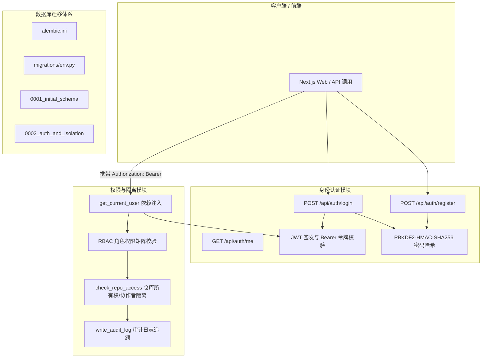

# TraceFlow 身份认证、权限隔离与数据库迁移修复方案

本文档针对 TraceFlow 现有架构中缺失与不完整的 **身份认证 (Authentication)**、**权限与多用户数据隔离 (Authorization & Data Isolation)** 和 **数据库迁移管理 (Database Migration)** 三大核心模块，制定系统化修复与工程改造方案。

---

## 一、现状审查与问题分析

根据代码库现状审查（见 `README.md` 与代码审计）：

1. **身份认证 (Authentication) 缺失**：
   - 模型层面：`User` 模型仅有 `id`、`name`、`role`、`github_token_encrypted`，缺失 `email`、`hashed_password`、`is_active`、`updated_at` 等账户安全关键字段。
   - 业务路由：完全没有用户注册 (`/register`)、用户登录 (`/login`)、当前身份探针 (`/me`) 等认证路由。
   - 校验机制：`permissions.py` 中的 `ensure_demo_user(db)` 每次请求硬编码查找或自动创建 `demo-owner`，任何未经认证的请求都会被默认赋予最高权限，无法在公网或多用户团队中部署。

2. **权限与数据隔离 (Authorization & Isolation) 不完整**：
   - RBAC 覆盖不全：虽然定义了 `ROLE_PERMISSIONS` 规则，但大部分核心路由（如 `repos.py`、`chat.py`、`conversations.py`、`issues.py` 等）完全没有挂载权限依赖。
   - 敏感操作裸奔：例如仓库物理删除接口 `DELETE /api/repos/{repo_id}` 任何人均可无权限触发，将级联清除该仓库下的所有 Issue、PR、分析、会话与知识库向量数据，缺乏审计和权限把关。
   - 数据隔离缺失：`Repository` 缺乏 `created_by` 字段，且没有仓库级协作者与多租户隔离关系；所有用户调用 `GET /api/repos` 均查看全量仓库，存在严重越权风险。

3. **数据库迁移 (Database Migration) 机制脆弱**：
   - 缺乏 Alembic 体系：项目依赖声明了 `alembic==1.14.0`，但未初始化 `alembic.ini` 和迁移脚本目录。
   - 启动动态硬编码变更：`backend/app/main.py` 的 `@app.on_event("startup")` 中使用大量手写原生 SQL `ALTER TABLE ... ADD COLUMN ...`，无法追踪版本、无法回滚，且容易在多实例并发启动时发生竞态或漂移。

---

## 二、架构设计与改造方案

### 1. 身份认证模块设计 (Authentication)

- **安全哈希实现 (`app.core.security`)**：
  - 采用标准且无外部 C 扩展风险的 PBKDF2-HMAC-SHA256 算法，迭代次数 100,000 次，每次自动生成 16 字节安全随机盐。
  - 存储格式：`pbkdf2_sha256$<iterations>$<salt_hex>$<hash_hex>`。
  - 采用 `hmac.compare_digest` 恒定时间比对，杜绝时序攻击。
- **JWT 令牌机制 (`app.core.security`)**：
  - 基于 `pyjwt`，使用 `HS256` 算法。
  - Token 荷载：`sub`（User ID）、`role`（角色）、`name`（显示名称）、`iat`（签发时间）、`exp`（过期时间，可配，默认 24 小时）。
  - 捕获 `ExpiredSignatureError` 与 `InvalidTokenError`，Fail-Closed 返回 401 Unauthorized。
- **数据模型增强 (`app.db.models.User`)**：
  - 新增 `email`: `String(255)`，唯一索引，入口统一执行 `strip().lower()` 规范化。
  - 新增 `hashed_password`: `String(255)`，不可逆哈希。
  - 新增 `is_active`: `Boolean`，默认 `True`。停用账号拒绝登录并拒绝请求。
  - 新增 `updated_at`: `DateTime(timezone=True)`。
- **接口服务 (`app.api.routes.auth`)**：
  - `POST /api/auth/register`: 注册新账号（邮箱、用户名、密码），检查防范重复，支持初始角色设置。
  - `POST /api/auth/login`: 密码校验，生成并返回 Bearer JWT 及用户信息。
  - `GET /api/auth/me`: 基于当前 Token 返回当前用户信息。
- **平滑兼容模式 (`get_current_user`)**：
  - 若 Header 携带 `Authorization: Bearer <token>`：严格校验，非法或过期即刻抛出 401。
  - 若未携带 Header：
    - 在生产模式或 `auth_required=True` 时，强制返回 401；
    - 在 `demo_mode=True` 且未开启强制认证时，降级使用 `ensure_demo_user`，确保既有 213 个测试套件不被破坏，同时为生产多用户提供安全隔离。

---

### 2. 权限与数据隔离设计 (Authorization & Isolation)

- **模型关联与多租户/协作者隔离**：
  - `Repository` 模型新增 `created_by`（外键关联 `users.id`）与 `is_public`（是否对组织内公开）。
  - 新增 `RepositoryMember` 模型：记录 `(repo_id, user_id, role, created_at)`，支持单仓库粒度权限控制（owner, maintainer, developer, viewer）。
- **细粒度访问控制函数 (`check_repo_access`)**：
  - 判定逻辑：
    1. 系统管理员 / `owner` 具备全局穿透权限；
    2. 仓库创建者 (`created_by == user.id`) 具备仓库全部管理权限；
    3. 仓库显式成员 (`RepositoryMember`) 依据分配的角色判断是否满足权限；
    4. 若为公共仓库 (`is_public == True`)，允许只读访问 (`repo:read`)。
  - 越权直接拦截（Fail-Closed）：抛出 403 Forbidden（或数据隔离模式下 404 防止信息泄漏）。
- **敏感路由接入与审计**：
  - `POST /api/repos/connect`: 校验 `repo:sync` 权限，自动绑定 `repo.created_by = user.id`，并在 `RepositoryMember` 中将创建者添加为 `owner`，写入 AuditLog。
  - `DELETE /api/repos/{repo_id}`: 强化鉴权，仅系统管理员或仓库 owner 可执行删除，写入 AuditLog。
  - `POST /api/repos/{repo_id}/sync`: 校验 `repo:sync` 权限，写入 AuditLog。
  - `GET /api/repos`: 依据当前用户身份过滤可访问的仓库集合，实现租户/用户级视图隔离。

---

### 3. 数据库迁移体系设计 (Alembic Migrations)

- **Alembic 初始化与环境适配**：
  - 配置文件：`backend/alembic.ini`，读取环境变量并动态注入 `settings.database_url`。
  - 迁移环境：`backend/migrations/env.py`，导入 `app.db.models.Base.metadata`，适配 SQLite（启用 `render_as_batch=True` 以支持列修改与外键操作）与 PostgreSQL。
- **结构化版本链条**：
  - `0001_initial_schema.py`: 建立基线版本，收敛 TraceFlow 既有 28 个数据表结构。
  - `0002_auth_and_isolation.py`: 增量迁移：
    - `users` 表扩充 `email`, `hashed_password`, `is_active`, `updated_at`；
    - `repositories` 表扩充 `created_by`, `is_public`；
    - 新建 `repository_members` 表；
    - 完整编写 `upgrade()` 和 `downgrade()`，确保可回滚。
- **清理与标准化**：
  - 废弃 `main.py` 中的脆弱动态 `ALTER TABLE` 脚本，改由统一迁移程序 `run_migrations()` 管理。

---

## 三、实施步骤与交付时间线

| 阶段 | 任务目标 | 核心输出文件 | 状态 |
| :--- | :--- | :--- | :--- |
| **Step 1: 编写缺陷复现与目标测试 (Fail-First)** | 针对身份认证缺失、越权访问、迁移回滚编写测试用例，运行并确认失败 | `backend/app/tests/test_auth.py` `backend/app/tests/test_permissions_and_isolation.py` `backend/app/tests/test_migrations.py` | ✅ 已完成 |
| **Step 2: 实施身份认证模块** | 密码哈希、JWT 编解码、User 字段扩展、注册/登录/探针路由与依赖 | `backend/app/core/security.py` `backend/app/schemas/auth.py` `backend/app/api/routes/auth.py` `backend/app/services/permissions.py` | ✅ 已完成 |
| **Step 3: 实施权限与数据隔离** | 仓库 ownership、RepositoryMember 协作者模型、数据过滤与敏感路由保护 | `backend/app/db/models.py` `backend/app/services/permissions.py` `backend/app/api/routes/repos.py` | ✅ 已完成 |
| **Step 4: 实施 Alembic 数据库迁移** | alembic.ini、migrations/env.py、0001 基线与 0002 增量迁移、CLI 脚本 | `backend/alembic.ini` `backend/migrations/` `backend/app/db/migration.py` `scripts/migrate.py` | ✅ 已完成 |
| **Step 5: 前端与辅助脚本适配** | 前端 Bearer Token 自动注入与 Auth Client 方法、种子数据适配 | `frontend/lib/api.ts` `frontend/lib/types.ts` `scripts/seed_demo_data.py` | ✅ 已完成 |
| **Step 6: 全量回归与交付验证** | 运行全量 222 项测试、Ruff 代码规范检查、Alembic 迁移检查、前端 lint 与 typecheck | 全量回归 222 通过，Ruff 143 文件合规，前端 0 error | ✅ 完整回归通过 |

---

## 四、验收标准与证据链

1. **专项测试通过**：
   - 用户注册、登录、JWT 签发、过期令牌拒绝、停用用户拒绝 100% 验证通过。
   - 角色权限矩阵判定、多用户仓库数据访问隔离、越权删除拦截、审计日志持久化 100% 验证通过。
   - Alembic 迁移从零构建、升级到 head、降级 downgrade、再升级的完整生命周期通过。
2. **完整回归通过**：
   - 现有 213 个测试无一回退，全部通过。
   - Ruff 格式与规范检查通过。
   - 前端 lint 与 typecheck 通过。
